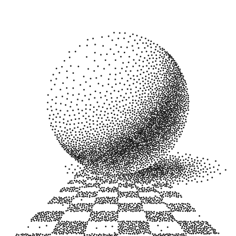

<p align="center"></p>

# Bottega

Un nucleo, tre dialetti. Bottega è un linguaggio totale con tipi dipendenti, scritto in Racket,
sopra cui si costruiscono linguaggi per casi d'uso diversi. Ognuno dichiara un piano come dato,
il type checker ne prova le proprietà, e un realizzatore che esiste già lo esegue.

| `#lang` | Che cosa dichiara | Chi lo realizza | Stato |
|---|---|---|---|
| `bottega` | la logica: Π, Σ, ≡, `data`, `record`, match dipendente, `auto` | — | fatto |
| `disegno` | la pipeline: il progetto, non l'esecuzione | Dagger (1.0 beta.28) | piano e run, AWS, git, ArgoCD; parità con Chez anche su be-tsid |
| `prospettiva` | un modello, molti ambienti come proiezioni; i teoremi sono le invarianti | Nix (flake, derivazioni) | values.yaml per ambiente |
| `affresco` | l'architettura di Elm, totale, lato server; le prove sono i test | un runtime Racket (HTTP) | vista, diff, eventi e timer; un contatore e un cronometro |

Il nome viene dalla bottega rinascimentale: il luogo dove il disegno diventa opera. L'apprendista
cominciava da due lezioni, una sfera con la luce, l'ombra e l'ombra portata, e un pavimento a
scacchi in prospettiva, le cui righe vanno tutte a un punto solo, come in Alberti. Sono il
disegno e la prospettiva, e insieme fanno il logo, a puntini (`racket tools/logo.rkt > logo.svg`).

```racket
#lang bottega
(require bottega/lib/paths)

(claim +-zero (Π ((n Nat)) (≡ (+ n 0) n)))
(define (+-zero n)
  (match n
    (zero     refl)
    ((add1 k) (cong add1 (+-zero k)))))

; i punti non si sommano: /out è un punto, "bin/hello" uno spostamento
(claim dentro (≡ (⊕ /out "bin/hello") /out/bin/hello))
(define dentro auto)
```

- **Scheme con i tipi**, nella forma di Pie (*The Little Typer*): `(claim nome tipo)`, poi
  `(define (nome x …) corpo)`. Solo tonde.
- **Totale**: ricorsione strutturale, copertura dei casi, positività stretta, universi stratificati.
  Un kernel ricontrolla ogni termine.
- **Si controlla compilando**: un errore ferma `raco make` alla sua riga, e DrRacket o
  racket-langserver lo mostrano nell'editor, con il tipo di ogni dichiarazione al passaggio del mouse.
- **`TODO`**, come in Pie: un buco nel corpo; il checker stampa il contesto e l'obiettivo.
- **Librerie curate**: `extern` e `builtin` stanno solo in `bottega/lib`; un programma le richiede
  con `require`.
- **Ogni modulo ha i suoi nomi**: vede quello che richiede, e una sua definizione nasconde quella
  importata (`account` può essere la tua funzione anche se `aws` ha il costruttore `account`). Un
  nome che due moduli richiesti definiscono in modo diverso è ambiguo dove lo si usa.

## Uso

Serve [Nix](https://nixos.org) con i flake.

```
nix develop                      # Racket, con il repo come collection bottega
raco make book/03-functions.rkt  # controlla un modulo
raco test tests/                 # i test e i teoremi delle librerie

racket cookbook/02-go-build.rkt plan                                  # il piano, in GraphQL
dagger api with-session racket cookbook/02-go-build.rkt run           # l'opera, su Dagger

racket cookbook/prospettiva/service.rkt show qa                       # una proiezione, in YAML
nix build .#example                                                   # tutte, come derivazione

racket cookbook/affresco/counter.rkt serve 8080                       # un programma, su localhost:8080
racket cookbook/affresco/timer.rkt serve 8080                         # un programma iscritto al tempo
nix run .#counter -- 8080                                             # lo stesso, costruito da Nix
nix flake check                                                       # i teoremi e i test
```

Per imparare il linguaggio c'è il libro in `book/`, nove capitoli sui tipi dipendenti, con le
soluzioni degli esercizi.

```
bottega/core/   il nucleo: superficie, elaborazione, kernel, definizioni
bottega/lib/    la libreria standard: prelude, text, affine, paths, time, net, aws
disegno/        il dialetto: piano, runner, sessione, generatore; disegno/lib le librerie: dagger, files, delivery, git, argocd, aws
prospettiva/    il dialetto dei modelli: proiezioni e YAML
affresco/       il dialetto dei programmi: runtime, diff, server; affresco/lib Html, Sub e Program
book/           il libro          cookbook/  le ricette; prospettiva/ e affresco/ gli esempi e i template
tests/          i test e i golden  tools/     il logo
```

Bottega nasce da [Disegno](https://github.com/avit-io/disegno), un linguaggio per la CI scritto in
Chez Scheme: il nucleo è lo stesso, ora comune a tutti i dialetti.

### Dietro un proxy TLS

Dietro un proxy che ispeziona il TLS (Netskope, per esempio) il motore Dagger avviato dalla CLI
non riesce a scaricare le immagini. `nix develop` avvia allora un motore suo,
`bottega-engine-v<versione>`, con il bundle CA dell'host montato: il motore installa le CA e le
passa ai container che esegue. Il bundle si sceglie con `BOTTEGA_HOST_CA` (un percorso, o `none`);
di default è quello di sistema.

### Un modello in un flake

Un repository di modelli parte dal template, e Nix costruisce le proiezioni senza IFD:

```
nix flake init -t github:avit-io/bottega#prospettiva
nix build          # result/<ambiente>/values.yaml
nix flake check    # i tipi e i teoremi del modello
```

Nel `flake.nix` è una riga: `bottega.lib.prospettiva { src = ./.; model = "service.rkt"; }`.

Il YAML viene dalla forma normale, in un modo solo: un record è una mappa con i nomi dei campi,
un'enumerazione il nome del costruttore, un altro costruttore la mappa dei suoi argomenti, un
letterale raffinato (`Port`, `Region`, `Arn`) il suo testo, le prove spariscono. Un campo
`(Maybe T)` che vale `nothing` è una chiave che non c'è.

### Un programma, e le sue prove

Un programma affresco è l'architettura di Elm: lo stato iniziale, `update` che a un messaggio
fa corrispondere il nuovo stato, `view` che dallo stato fa la pagina. Il runtime tiene lo stato
sul server, e al browser manda solo le differenze tra una pagina e la successiva. I test si
scrivono prima, ma sono prove: «dec annulla inc», «la vista offre tre bottoni, in quest'ordine,
in ogni stato», «scrivere nel campo rinomina». Se il programma le rompe non compila, e l'errore
dice quale:

```
counter.rkt:74:26: three-buttons: refl: expected (≡ (:: inc (:: reset (:: inc nil))) (:: dec …
```

Un programma dice anche a che cosa è iscritto, in ogni stato: `subs`, che oggi conosce solo il
tempo (`every`). Il cronometro (`cookbook/affresco/timer.rkt`) è iscritto a un tick al secondo solo
mentre corre, e lo prova: «fermo, il tempo non lo raggiunge». Il runtime accende e spegne i timer
quando le iscrizioni cambiano; clic e tick arrivano al browser su un solo stream, nell'ordine del
server. `Cmd` non c'è: `update` resta puro.

```
nix flake init -t github:avit-io/bottega#affresco
nix build           # le prove
nix run . -- 8080   # il programma
```
